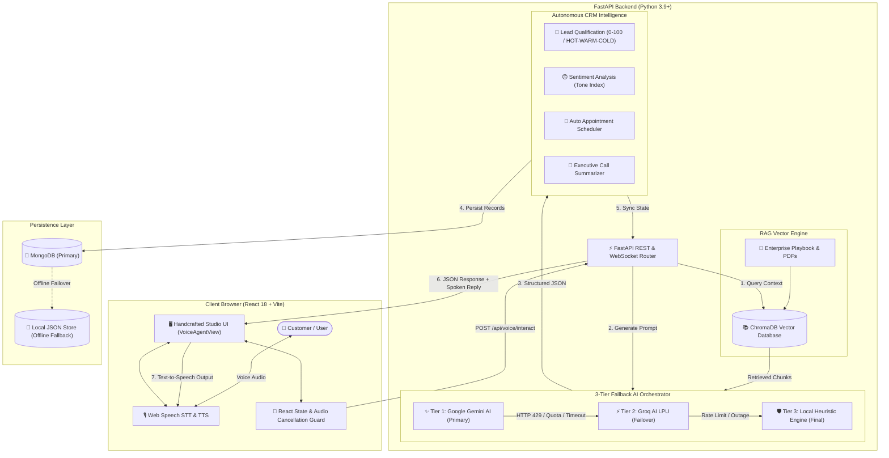
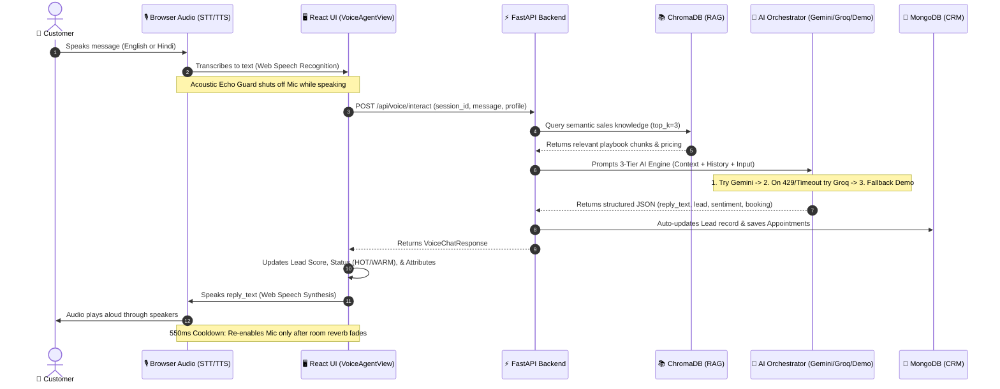

# FORTIVOICE – Complete System Architecture & Step-by-Step Workflow Guide

> **Autonomous AI Sales Voice Agent & Smart CRM**  
> *Author:* Ayush Kumar  
> *Project Repo:* [https://github.com/Ayushkumar1210/fortivoice](https://github.com/Ayushkumar1210/fortivoice)  
> *Tech Stack:* React (Vite), Tailwind CSS, FastAPI (Python 3.9+), MongoDB, ChromaDB, Google Gemini AI, Groq AI, Web Speech API

---

## 1. High-Level Architecture Diagram



---

## 2. Project Directory Structure

```plaintext
voice-assitant/
├── start.sh                        # 🚀 Single-command launcher for both Frontend & Backend
├── PROJECT_REPORT.md               # 📋 Comprehensive technical evaluation report
├── ARCHITECTURE_AND_WORKFLOW.md   # 📖 This architecture & step-by-step documentation
├── README.md                       # 📄 GitHub project documentation & setup guide
├── .gitignore                      # 🔒 Excludes secrets (.env), node_modules, and virtualenvs
│
├── backend/                        # ⚡ FastAPI Python Backend
│   ├── .env.example                # Safe public template for environment variables
│   ├── .gitignore                  # Backend-specific ignore rules
│   ├── requirements.txt            # Python dependencies (FastAPI, Motor, ChromaDB, etc.)
│   ├── app/
│   │   ├── main.py                 # FastAPI application root & CORS middleware
│   │   ├── api/                    # REST API Endpoints
│   │   │   ├── voice.py            # POST /api/voice/interact (Main conversational pipeline)
│   │   │   ├── leads.py            # GET/POST/PUT/DELETE /api/leads (CRM lead management)
│   │   │   ├── appointments.py     # GET/POST/PUT/DELETE /api/appointments (Demo calendar)
│   │   │   ├── calls.py            # GET/POST /api/calls & /summary (Call logs & AI summary)
│   │   │   ├── rag.py              # POST /api/rag/upload & /query (Vector store sandbox)
│   │   │   ├── analytics.py        # GET /api/analytics/dashboard (CRM KPIs & stats)
│   │   │   └── settings.py         # GET/POST /api/settings (API key tests & provider config)
│   │   ├── core/
│   │   │   ├── config.py           # Pydantic Settings reading backend/.env
│   │   │   ├── database.py         # Dual-mode DB manager (MongoDB + Local JSON fallback)
│   │   │   └── exceptions.py       # Custom typed exceptions (AIRateLimitError, etc.)
│   │   ├── models/
│   │   │   └── schemas.py          # Pydantic v2 data models & request/response validation
│   │   └── services/
│   │       ├── ai_service.py       # 3-tier AI Orchestrator (Gemini -> Groq -> Local Demo)
│   │       ├── gemini_service.py   # Primary Google Gemini API integration & prompt engine
│   │       ├── groq_service.py     # Secondary Groq API LPU integration
│   │       ├── rag_service.py      # ChromaDB vector embedding, chunking & semantic search
│   │       ├── lead_service.py     # Lead scoring, hot/warm classification & multi-turn merge
│   │       ├── appointment_service.py # Calendar booking logic & validation
│   │       └── call_service.py     # Call transcript storage & executive summary generator
│   └── tests/                      # 🧪 Automated Test Suite (21 / 21 Passing)
│       ├── test_api.py             # CRUD, Health, RAG semantic search & voice flow tests
│       ├── test_fallback.py        # Gemini -> Groq -> Local Demo 3-tier fallback tests
│       └── test_e2e_workflow.py    # Full multi-turn sales simulation test
│
└── frontend/                       # 🖥️ React.js + Vite Client Application
    ├── index.html                  # HTML entry with Plus Jakarta Sans & JetBrains Mono fonts
    ├── package.json                # Dependencies (React 18, Lucide React, Tailwind)
    ├── vite.config.js              # Vite bundler configuration
    ├── tailwind.config.js          # Custom theme configuration
    └── src/
        ├── App.jsx                 # Main layout, tab navigation & global audio lifecycle guard
        ├── index.css               # Humanized studio canvas styling, paper grain & craft cards
        ├── main.jsx                # React DOM root render
        ├── components/
        │   ├── Header.jsx          # Live engine status indicator, title & language toggle
        │   ├── Sidebar.jsx         # Studio frosted navigation sidebar & system status footer
        │   ├── VoiceAgentView.jsx  # Main AI Voice console, live waveform, transcript & lead panel
        │   ├── AudioWaveform.jsx   # Real-time animated audio visualizer
        │   ├── DashboardView.jsx   # CRM KPIs, conversion charts & recent activities
        │   ├── LeadsView.jsx       # CRM lead pipeline table, search, filters & details modal
        │   ├── AppointmentsView.jsx# Calendar demo bookings & meeting manager
        │   ├── CallHistoryView.jsx # Audio call records, duration & transcript logs
        │   ├── KnowledgeBaseView.jsx# PDF/TXT upload bench & RAG query tester
        │   └── SettingsView.jsx    # Live AI provider test bench (Gemini & Groq tester)
        └── services/
            ├── api.js              # Fetch client with AbortController 20s safety timeout
            └── speechService.js    # Browser SpeechRecognition (STT) & SpeechSynthesis (TTS)
```

---

## 3. Step-by-Step Execution Workflow

The complete conversational life cycle operates through **10 coordinated steps**:



---

### Detailed Breakdown of Every Step

#### Step 1: User Voice Capture & Client-Side Processing
- **Component:** `frontend/src/services/speechService.js` and `VoiceAgentView.jsx`
- **What happens:**
  1. The customer speaks into the microphone (in English or Hindi).
  2. The browser's native `webkitSpeechRecognition` processes the audio stream locally with zero telephony latency.
  3. Interim speech is displayed live in blue ("Transcribing..."). Once the user pauses, a `final` transcript is emitted.
  4. **Acoustic Echo Cancellation (AEC):** The microphone is **immediately aborted** the millisecond the message is submitted, preventing the mic from picking up computer speaker audio.

#### Step 2: FastAPI Routing & Request Validation
- **Component:** `backend/app/api/voice.py` & `backend/app/models/schemas.py`
- **What happens:**
  1. The client sends a `POST /api/voice/interact` request containing:
     - `session_id`: Unique identifier for the ongoing sales call.
     - `message`: The transcribed text string.
     - `language`: `"en"` or `"hi"`.
     - `customer_profile`: Current lead profile state.
     - `conversation_history`: Recent dialogue turns.
  2. Pydantic v2 validates the schema and passes data to the service layer.

#### Step 3: Semantic Knowledge Retrieval (RAG)
- **Component:** `backend/app/services/rag_service.py`
- **What happens:**
  1. The customer message is queried against the local **ChromaDB vector collection**.
  2. The vector engine finds the top 3 most semantically relevant text chunks from the pre-seeded Enterprise Sales Playbook (`fortivoice_enterprise_playbook.txt`) or user-uploaded PDFs.
  3. Extracted chunks (with pricing rules, plan limits, and SLAs) are formatted into a `rag_context` block to ground the LLM and completely eliminate hallucination.

#### Step 4: 3-Tier Zero-Downtime AI Inference
- **Component:** `backend/app/services/ai_service.py`
- **What happens:**
  - **Tier 1 (Primary - Google Gemini AI):** Request is sent to Google Gemini (`gemini-3.8-flash`). If successful, returns in <1.5s.
  - **Tier 2 (Failover - Groq AI):** If Gemini returns HTTP 429 (quota exhausted), rate limits, or times out after 3.0 seconds, the orchestrator immediately catches the exception and routes the exact prompt to Groq (`qwen/qwen3.8-27b`). Groq responds via LPUs in <1.0s.
  - **Tier 3 (Final - Local Heuristic Engine):** If both remote APIs are unavailable or offline, the local rule-based engine generates natural responses, lead scoring, and appointment detection so the demo **never crashes**.
  - **Structured Output:** All tiers return strictly valid JSON containing:
    - `reply_text`: Conversational response for the customer.
    - `extracted_lead`: Contact details detected in the turn.
    - `sentiment`: Positive, Neutral, or Negative.
    - `lead_score`: Score from 0 to 100.
    - `lead_status`: HOT, WARM, or COLD.
    - `appointment_intent`: Preferred date and time if booking was requested.

#### Step 5: Commercial Lead Qualification & Scoring
- **Component:** `backend/app/services/lead_service.py`
- **What happens:**
  1. Attributes are extracted: **Name**, **Company**, **Phone**, **Email**, **Product Interest**, **Budget**, and **Timeline**.
  2. Scoring criteria applied:
     - **HOT (75–100):** High budget ($1,500+ / Enterprise), immediate timeline, decision-maker, or demo booking requested.
     - **WARM (40–74):** Moderate interest, evaluating solutions, browsing pricing.
     - **COLD (0–39):** Unresponsive, budget below minimum Starter tier ($499/mo), or competitor research.
  3. **Multi-Turn Enrichment:** If the user gives their Name in Turn 1 and Phone/Budget in Turn 2, `lead_service.upsert_from_voice_session` safely merges the fields without overwriting previous data.

#### Step 6: Sentiment Analysis
- **Component:** `backend/app/services/gemini_service.py` & `groq_service.py`
- **What happens:**
  1. Analyzes customer emotion and tone index (-1.0 to +1.0).
  2. Classifies into **Positive** (enthusiastic, eager), **Neutral** (asking factual questions), or **Negative** (hesitant, objections).
  3. Updates the live sentiment gauge on the CRM dashboard.

#### Step 7: Autonomous Appointment Booking
- **Component:** `backend/app/services/appointment_service.py`
- **What happens:**
  1. If the customer says *"Can we schedule a demo tomorrow at 2 PM?"*, the AI detects the booking intent.
  2. Converts relative dates ("tomorrow", "next Friday") into standardized `YYYY-MM-DD` and `HH:MM`.
  3. Automatically inserts a scheduled appointment record into MongoDB.
  4. Automatically promotes the lead score by +15 points to **HOT LEAD** status.

#### Step 8: Database Persistence & Fault-Tolerant Storage
- **Component:** `backend/app/core/database.py`
- **What happens:**
  1. All records (leads, appointments, call history) are saved to **MongoDB** using the asynchronous `motor` driver.
  2. **Immutable `_id` Sanitization:** Automatically strips `_id` and `id` from update dictionaries before running `$set` operations, preventing MongoDB Code 66 errors.
  3. **Offline Fallback:** If MongoDB is ever stopped or unreachable, the system transparently falls back to an atomic in-memory JSON document store in `./data/db.json` so the app keeps working.

#### Step 9: Speech Synthesis (TTS) & Audio Feedback Guard
- **Component:** `frontend/src/services/speechService.js` & `VoiceAgentView.jsx`
- **What happens:**
  1. The backend JSON arrives in the browser.
  2. The reply text is stripped of any markdown symbols (`*`, `#`, `` ` ``) so TTS sounds natural.
  3. The browser's `window.speechSynthesis` speaks the reply using natural English or Hindi voices.
  4. **550ms Acoustic Reverb Cooldown:** When the AI finishes speaking, a 550ms timer allows laptop speaker reverb to completely dissipate. Only then is the microphone re-engaged for the user's next turn.
  5. **Deduplication Check (`isSelfEcho`):** If the mic accidentally hears any snippet of the AI's own recent words, it is flagged as bleed-through and discarded.

#### Step 10: Executive Call Summary Generation
- **Component:** `backend/app/api/calls.py` & `backend/app/services/call_service.py`
- **What happens:**
  1. When the call is concluded by clicking **"End Call & Summarize"**, the complete conversation transcript is sent to `/api/calls/summary`.
  2. The AI generates an executive CRM briefing:
     - **Call Overview:** 2–3 paragraph summary.
     - **Customer Requirements:** Exact volume, integrations, and needs.
     - **Customer Objections:** Hesitations or pricing concerns raised.
     - **Recommended Next Action:** Clear task for the sales team (e.g. *"Send Enterprise Custom pricing proposal and demo invite for Thursday at 2 PM"*).
  3. The call record is saved to MongoDB and immediately accessible under **Call History** and **Dashboard**.

---

## 4. How to Run the Project Anytime

### Single-Command Launcher (Easiest)
```bash
./start.sh
```

### Or Run in Two Separate Terminals

**Terminal 1 – Backend:**
```bash
cd backend
source venv/bin/activate
uvicorn app.main:app --host 127.0.0.1 --port 8000 --reload
```

**Terminal 2 – Frontend:**
```bash
cd frontend
npm run dev
```

### URLs
- **CRM Web Application:** [http://127.0.0.1:5173](http://127.0.0.1:5173)
- **FastAPI Interactive API Docs:** [http://127.0.0.1:8000/docs](http://127.0.0.1:8000/docs)
- **Backend Health Check:** [http://127.0.0.1:8000/health](http://127.0.0.1:8000/health)

---

## 5. Technical Interview Q&A Cheatsheet

**Q: Why use a 3-tier fallback architecture (Gemini → Groq → Local Demo)?**  
*A:* Free-tier LLM APIs (like Gemini free tier) have strict rate limits (20 requests/day). If an enterprise client demo hits HTTP 429 quota exhaustion or network timeouts, the app automatically switches to Groq LPU in <1 second without crashing, and falls back to a deterministic local engine if all remote networks fail.

**Q: How did you solve the voice agent recording its own voice (echo loop)?**  
*A:* Implemented a 4-layer defense:
1. Hard half-duplex muting (mic is forcefully aborted when the agent starts speaking).
2. 550ms safety cooldown after speech ends before re-opening the mic, allowing speaker room reverb to fade.
3. Acoustic self-echo cancellation filter (`isSelfEcho`) that compares incoming transcripts against the AI's recent reply and drops matching phrases.
4. Clean audio cancellation when switching tabs in React.

**Q: Why use ChromaDB with fallback instead of calling the LLM directly?**  
*A:* LLMs frequently hallucinate custom pricing or contract terms. By chunking company sales playbooks and storing them as vector embeddings in ChromaDB, every customer question is grounded with exact enterprise documentation before the LLM generates a response.
