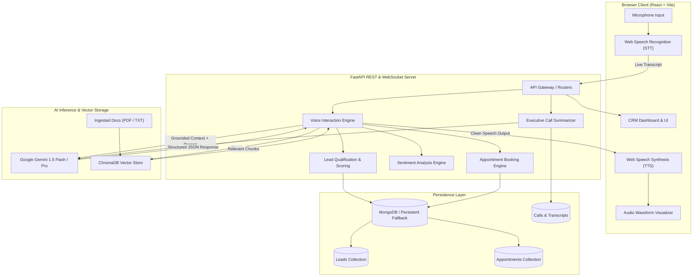

# FORTIVOICE – Autonomous AI Sales Voice Agent & Smart CRM

[](https://fastapi.tiangolo.com)
[](https://reactjs.org)
[](https://tailwindcss.com)
[](https://aistudio.google.com)
[](https://www.trychroma.com)
[](https://www.mongodb.com)

**FORTIVOICE** is an enterprise-grade autonomous AI voice agent and intelligent CRM platform. It engages prospective clients over real-time voice, grounds product conversations in company documentation via RAG, automatically extracts and scores leads (HOT / WARM / COLD), performs live sentiment analysis, schedules calendar demo appointments, and generates executive post-call summaries.

---

## 🏗️ System Architecture



---

## ⚡ Core Features

1. **Autonomous Conversational Voice Agent**:
   - Interactive hands-free voice experience powered by the browser's native Web Speech Recognition (STT) and Web Speech Synthesis (TTS).
   - Supports natural multilingual communication in **English** and **Hindi**.
   - Real-time reactive audio visualizer waveform canvas with state indicators (*Listening, Speaking, Thinking, Idle*).
   - Text fallback input bar for silent environments or testing.

2. **Intelligent Lead Qualification & Scoring**:
   - Automatically extracts prospect attributes: Name, Phone, Email, Product Interest, Budget, Requirements, and Purchase Timeline.
   - Computes dynamic Lead Score from **0 to 100** based on commercial urgency, budget threshold, and interest.
   - Categorizes leads into **HOT** (75-100), **WARM** (40-74), and **COLD** (0-39) with transparent AI reasoning explanations.

3. **Sentiment Analysis**:
   - Classifies customer tone (*Positive*, *Neutral*, *Negative*) and tracks sentiment index (-1.0 to +1.0) with real-time CRM updates.

4. **RAG Knowledge Base (ChromaDB)**:
   - Supports uploading PDF and TXT corporate product guides, sales playbooks, and security policies.
   - Chunks text, generates embeddings, and performs semantic similarity search.
   - Prevents AI hallucinations by strictly grounding replies in company data.
   - Includes an interactive RAG search sandbox to verify vector retrieval in real-time.

5. **Autonomous Appointment Booking**:
   - Detects demo scheduling requests (e.g., *"Let's schedule a demo next Friday at 2 PM"*).
   - Validates future dates and flags duplicate slot collisions.
   - Persists appointments to MongoDB and synchronizes with the CRM calendar.

6. **Executive AI Call Summaries**:
   - Synthesizes call transcripts into executive summaries, customer requirements, identified objections, and recommended next steps for sales reps.

7. **Production-Grade SaaS CRM Dashboard**:
   - KPI cards for pipeline conversion rate, hot leads, total calls, and average lead scores.
   - Dedicated views: *Dashboard, AI Voice Agent, Leads Management, Appointments, Call History, Knowledge Base, and Settings*.

---

## 🚀 Quick Start Guide

### Prerequisites
- Node.js (v18+) and npm
- Python (3.9+)
- (Optional) MongoDB running on `mongodb://localhost:27017` (A persistent fallback is automatically enabled if MongoDB is not running).
- (Optional) Google Gemini API Key from [Google AI Studio](https://aistudio.google.com/).

---

### Step 1: Backend Setup

```bash
cd backend

# Create virtual environment
python3 -m venv venv
source venv/bin/activate

# Install dependencies
pip install --upgrade pip
pip install -r requirements.txt

# (Optional) Configure environment variables
cp .env.example .env
# Edit .env with your GEMINI_API_KEY if available

# Run unit tests to verify system health
pytest tests/test_api.py -v

# Start FastAPI backend server
uvicorn app.main:app --host 127.0.0.1 --port 8000 --reload
```
Backend will be live at `http://127.0.0.1:8000` with interactive Swagger docs at `http://127.0.0.1:8000/docs`.

---

### Step 2: Frontend Setup

Open a new terminal window:

```bash
cd frontend

# Install frontend dependencies
npm install

# Start Vite React development server
npm run dev
```
Frontend will be running at `http://127.0.0.1:5173`.

---

## 📡 REST API Documentation

| Method | Endpoint | Description |
|---|---|---|
| `GET` | `/health` | System health check & DB status |
| `POST` | `/api/voice/interact` | Core voice pipeline: RAG + Gemini + Lead scoring + Sentiment + Auto-booking |
| `WS` | `/api/voice/ws/{session_id}` | Live bi-directional voice WebSocket |
| `GET` | `/api/leads` | List leads (supports `status` and `search` query parameters) |
| `POST` | `/api/leads` | Create a lead record |
| `PUT` | `/api/leads/{id}` | Update lead details |
| `DELETE` | `/api/leads/{id}` | Remove lead |
| `GET` | `/api/appointments` | List calendar appointments |
| `POST` | `/api/appointments` | Book appointment (validates date & conflict checking) |
| `PUT` | `/api/appointments/{id}` | Update appointment status (*Scheduled, Completed, Cancelled*) |
| `GET` | `/api/calls` | Retrieve call logs and conversation transcripts |
| `POST` | `/api/calls/summary` | Generate post-call executive summary using Gemini |
| `GET` | `/api/rag/documents` | List ingested corporate knowledge base documents |
| `POST` | `/api/rag/upload` | Upload and chunk PDF or TXT files into ChromaDB |
| `POST` | `/api/rag/query` | Run semantic vector search against knowledge base |
| `GET` | `/api/analytics/dashboard` | Aggregated CRM analytics, KPI metrics, and activity feed |
| `GET` | `/api/settings` | Retrieve active LLM model, DB status, and vector stats |
| `POST` | `/api/settings` | Update Gemini API Key and model |
| `POST` | `/api/settings/test-gemini` | Verify live connection to Google Gemini API |

---

## 🔒 Security Architecture
- **Zero Frontend Secrets**: API keys (`GEMINI_API_KEY`, MongoDB credentials) are stored securely on the backend in `.env` and never leaked to browser client code.
- **CORS Protection**: Explicit cross-origin resource sharing controls restricting unauthorized origins.
- **Input Sanitization & TTS Shield**: Agent responses are sanitized to strip markdown formatting (`*`, `#`, code blocks) before synthesis to prevent pronunciation glitches.
- **No Data Training**: Corporate proprietary sales calls and uploaded documents are stored in private local collections and never used to train public foundation models.

---

## 📈 Scalability Strategy for 100,000 Users

1. **Stateless FastAPI Horizontal Scaling**:
   - Containerize backend via Docker and deploy on Kubernetes (EKS / GKE) with Horizontal Pod Autoscaling (HPA) governed by CPU and request throughput metrics.
2. **Distributed Vector Database**:
   - Transition ChromaDB from local disk mode to a clustered vector database (e.g., Pinecone, Qdrant, or Milvus) behind a caching layer (Redis) for frequent semantic queries.
3. **Database Sharding & Connection Pooling**:
   - Deploy MongoDB Atlas with sharded replica sets indexed by `tenant_id` and `customer_id`.
   - Implement connection pooling and async drivers (`Motor`).
4. **WebSocket & Media Stream Offloading**:
   - Integrate WebRTC or LiveKit / Twilio Media Streams for carrier-grade telephony integration with distributed audio edge relays.
5. **LLM Request Queue & Rate Limiting**:
   - Utilize Celery / Redis Queue with token bucket rate limiters to balance burst traffic and manage Gemini API quotas with graceful fallback.

---

## 💰 Estimated Infrastructure Costs (Monthly @ 10,000 calls / month)

| Service | Specification | Monthly Cost (USD) |
|---|---|---|
| **FastAPI Compute** | 2x AWS ECS Fargate / GCP Cloud Run (4 vCPU, 8GB RAM) | $90.00 |
| **MongoDB Atlas** | M10 Cluster (General Purpose, Automated Backups) | $60.00 |
| **Vector DB (Chroma / Pinecone)** | Standard Pod (100k vectors, 99.9% SLA) | $70.00 |
| **Google Gemini 1.5 Flash** | ~150M tokens (~10,000 multi-turn voice sessions) | $45.00 |
| **Cloud Storage & CDN** | AWS S3 + CloudFront / GCP Cloud Storage (Documents & Audio) | $15.00 |
| **Logging & Monitoring** | Datadog / OpenTelemetry + CloudWatch | $30.00 |
| **Total Estimated Run Rate** | **Enterprise Ready** | **~$310.00 / mo** |

---

## 🧪 Running Automated Tests

```bash
cd backend
./venv/bin/pytest tests/test_api.py -v
```

All 9 test suites validate:
- System health and endpoints
- Lead CRUD operations
- Appointments validation and duplicate prevention
- RAG vector semantic query retrieval
- Multi-turn voice interaction pipeline
- AI executive call summarization
- Dashboard analytics aggregation
- Settings and API configuration
